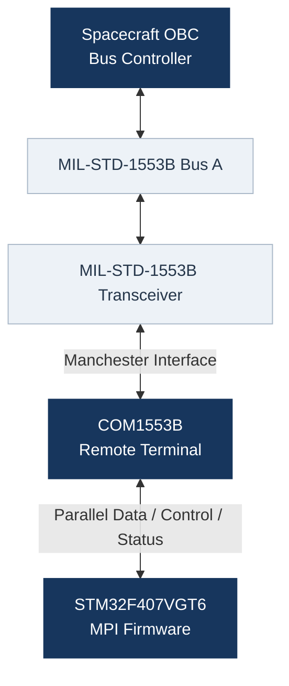

# FIRMWARE_1553

**MIL-STD-1553B Remote Terminal Firmware**

---

## Overview

Embedded firmware for MIL-STD-1553B communication control and management using the **COM1553B controller** operating in **Remote Terminal (RT)** mode with an STM32 microcontroller.

## Hardware

| Component | Device |
|:----------|:-------|
| Microcontroller | STM32F407VGT6 |
| Development Board | STM32F407G-DISC1 |
| MIL-STD-1553B Controller | COM1553B |
| Operating Mode | Remote Terminal (RT) |
| Development Tools | STM32CubeMX / STM32CubeIDE |

## Firmware Architecture

The firmware will include:

- Hardware abstraction and peripheral initialization.
- COM1553B interface drivers.
- Interrupt-driven communication handling.
- Remote Terminal command and data processing.
- Error detection and diagnostic mechanisms.

## Documentation

Technical documentation, hardware configurations, interface specifications, communication protocols, and test procedures are maintained in the `docs/` directory.

### Hardware

- [Pinout and Signal Configuration](docs/hardware/pinout.md)

### Communication Protocol

- [MIL-STD-1553 Protocol Documentation (PDF)](docs/protocol/mil-std-1553.pdf)

## 2. System Architecture

The communication architecture consists of the spacecraft OBC, the MIL-STD-1553B physical bus, the external transceiver, the COM1553B controller, and the STM32F407 host processor.

---
### 2.1 Communication Roles

**Spacecraft OBC — Bus Controller**

- Initiates MIL-STD-1553B transactions.
- Controls communication scheduling.
- Transmits commands and receives Remote Terminal responses.

**COM1553B — Remote Terminal**

- Implements MIL-STD-1553B communication functions.
- Processes command and data words.
- Generates status and response information.
- Provides the host processor with a parallel interface.

**STM32F407 — Host Processor**

- Initializes and controls the COM1553B.
- Exchanges data through the parallel bus.
- Handles controller events and handshake sequences.
- Manages communication buffers.
- Performs diagnostics and error handling.
- Interfaces the controller with the remaining MPI firmware.

The current hardware implementation focuses on **Bus A**.

## Development Environment

- **STM32CubeMX:** Peripheral and pin configuration.
- **STM32CubeIDE:** Firmware development and debugging.
- **STM32 HAL:** Hardware abstraction library.
- **Git / GitHub:** Version control and technical documentation.

---

**Project Status:** In Development

