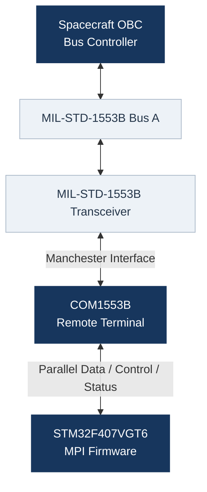

# Pinout

**FIRMWARE_1553** / Hardware Documentation


**Development Board:** STM32F407G-DISC1  
**Microcontroller:** STM32F407VGT6  
**Communication Standard:** MIL-STD-1553B  
**Document Revision:** 0.1

---

## 1. Overview

This document defines the signal configuration and pin assignments between the **STM32F407VGT6** microcontroller and the **COM1553B** MIL-STD-1553B controller.

The STM32F407 acts as the host processor and manages the COM1553B through a 16-bit bidirectional parallel data bus, control signals, and status monitoring.

This document covers:

- COM1553B signal identification and classification.
- STM32 GPIO assignments.
- Parallel data bus configuration.
- Control and handshake signals.
- Status and diagnostic signals.
- Clock generation.
- Interrupt considerations.
- Hardware validation requirements.

> [!NOTE]
> This document describes the current hardware configuration.
> Pin assignments marked as `TBD` have not yet been defined.
> Assignments will be updated as the STM32CubeMX configuration progresses.

### 1.1 Configuration Status

| Status | Description |
|:-------|:------------|
| Configured | Assigned and configured in STM32CubeMX |
| Pending | Pin assignment or configuration not yet defined |
| Pending Validation | Configured but not experimentally verified |
| Verified | Confirmed through hardware testing |

A configuration is considered verified only after the corresponding hardware test has been completed successfully.

---

## 2. System Architecture

The communication architecture consists of the spacecraft OBC, the MIL-STD-1553B physical bus, the external transceiver, the COM1553B controller, and the STM32F407 host processor.



### 2.1 Communication Roles

**Spacecraft OBC — Bus Controller**

- Initiates MIL-STD-1553B transactions.
- Controls communication scheduling.
- Transmits commands and receives Remote Terminal responses.

**COM1553B — Remote Terminal**

- Implements MIL-STD-1553B communication functions.
- Processes command and data words.
- Generates status and response information.
- Provides the host processor with a parallel interface.

**STM32F407 — Host Processor**

- Initializes and controls the COM1553B.
- Exchanges data through the parallel bus.
- Handles controller events and handshake sequences.
- Manages communication buffers.
- Performs diagnostics and error handling.
- Interfaces the controller with the remaining MPI firmware.

The current hardware implementation focuses on **Bus A**.

---

## 3. COM1553B Signal Classification

This section groups the COM1553B interface signals by functionality.

The classification is based on the COM1553B datasheet and the existing firmware interface developed during preliminary testing.

Signal directions for host-interface signals are defined with respect to the STM32F407.

### 3.1 Parallel Data Bus

The COM1553B provides a 16-bit bidirectional data bus.

| Signal | Direction | Description |
|:-------|:----------|:------------|
| D0 | Bidirectional | Data bit 0 |
| D1 | Bidirectional | Data bit 1 |
| D2 | Bidirectional | Data bit 2 |
| D3 | Bidirectional | Data bit 3 |
| D4 | Bidirectional | Data bit 4 |
| D5 | Bidirectional | Data bit 5 |
| D6 | Bidirectional | Data bit 6 |
| D7 | Bidirectional | Data bit 7 |
| D8 | Bidirectional | Data bit 8 |
| D9 | Bidirectional | Data bit 9 |
| D10 | Bidirectional | Data bit 10 |
| D11 | Bidirectional | Data bit 11 |
| D12 | Bidirectional | Data bit 12 |
| D13 | Bidirectional | Data bit 13 |
| D14 | Bidirectional | Data bit 14 |
| D15 | Bidirectional | Data bit 15 |

The host processor must support input and output operation.

GPIO direction shall be configured according to the COM1553B transfer cycle.

> [!IMPORTANT]
> The parallel interface must prevent bus contention.
>
> The STM32F407 and COM1553B must never drive the same data lines simultaneously.

### 3.2 Clock and Configuration

| Signal | Direction | Function |
|:-------|:----------|:---------|
| CLK | STM32 → COM1553B | 12 MHz reference clock |
| POR | STM32 → COM1553B | Controller reset |
| RT/BC | STM32 → COM1553B | Operating mode selection |

**Configuration requirements:**

- The COM1553B requires a 12 MHz reference clock.
- `POR` is used to reset the controller.
- `RT/BC` selects the required operating mode.
- The selected operating mode is Remote Terminal.
- Reset and startup timing must comply with the controller datasheet.

### 3.3 Control Signals

| Signal | Direction | Function |
|:-------|:----------|:---------|
| CSTR | STM32 → COM1553B | Command Strobe |
| BGACK | STM32 → COM1553B | Bus Grant Acknowledge |
| DTACK | STM32 → COM1553B | Data Transfer Acknowledge |

These signals coordinate host control operations and data transfers.

The firmware must manage their assertion and release according to the COM1553B timing requirements.

### 3.4 Handshake Signals

| Signal | Direction | Function |
|:-------|:----------|:---------|
| CSTRA | COM1553B → STM32 | Command Strobe Acknowledge |
| DTR | COM1553B → STM32 | Data Transfer Request |

These signals participate in the handshake between the controller and host processor.

The final firmware design will evaluate interrupt-driven detection to support time-critical operations.

### 3.5 Status and Monitoring Signals

| Signal | Planned Direction | Function |
|:-------|:------------------|:---------|
| R/W | Input | Read/write operation indication |
| WE | Input | Write Enable |
| C/D | Input | Command/Data indication |
| TXMODE | Input | Transmission mode indication |
| MC | Input | Message Complete |
| IM | Input | Invalid Message |
| MCF | Input | Mode Code Flag |
| VC | Input | Valid Command indication |

These signals support:

- Identification of transfer operations.
- Monitoring of controller activity.
- Message completion detection.
- Error and diagnostic reporting.
- Communication event handling.

The electrical direction and timing of each signal must be confirmed against the final COM1553B pin-function table before implementing the STM32 GPIO configuration.

### 3.6 Manchester Interface

The COM1553B uses a dedicated Manchester interface to communicate with the external MIL-STD-1553B transceiver.

| Signal | COM1553B Direction | Function |
|:-------|:-------------------|:---------|
| MANIN | Input | Manchester receive input |
| Complementary MANIN | Input | Complementary receive input |
| MANOUT | Output | Manchester transmit output |
| Complementary MANOUT | Output | Complementary transmit output |

These signals connect to the external transceiver rather than the STM32 host GPIO interface.

### 3.7 Additional Hardware Signals

The complete schematic must also account for:

- Controller power and ground connections.
- Transceiver interface signals.
- Hardware configuration inputs.
- Fixed-level control inputs.
- Reserved or unused pins.

Power distribution is handled separately from this document.

---

## 4. STM32 Pin Assignment

This section defines the physical correspondence between COM1553B signals and STM32F407 GPIO pins.

The final assignments will be implemented in STM32CubeMX.

### 4.1 Clock and Configuration

| COM1553B Signal | STM32 Pin | Configuration | Status |
|:----------------|:----------|:--------------|:-------|
| CLK | PE9 | TIM1_CH1 / PWM | Pending Validation |
| POR | TBD | GPIO Output | Pending |
| RT/BC | TBD | GPIO Output | Pending |

**Current assignment:**

`COM1553_CLK → PE9 → TIM1_CH1`

PE9 is reserved for generating the 12 MHz COM1553B clock.

### 4.2 Control and Handshake

| COM1553B Signal | STM32 Pin | GPIO Configuration | Status |
|:----------------|:----------|:-------------------|:-------|
| CSTR | TBD | GPIO Output | Pending |
| BGACK | TBD | GPIO Output | Pending |
| DTACK | TBD | GPIO Output | Pending |
| CSTRA | TBD | GPIO Input / EXTI candidate | Pending |
| DTR | TBD | GPIO Input / EXTI candidate | Pending |

The interrupt configuration will be determined after reviewing the required timing and available EXTI lines.

### 4.3 Parallel Data Bus

| COM1553B Signal | STM32 Pin | GPIO Configuration | Status |
|:----------------|:----------|:-------------------|:-------|
| D0 | TBD | Bidirectional GPIO | Pending |
| D1 | TBD | Bidirectional GPIO | Pending |
| D2 | TBD | Bidirectional GPIO | Pending |
| D3 | TBD | Bidirectional GPIO | Pending |
| D4 | TBD | Bidirectional GPIO | Pending |
| D5 | TBD | Bidirectional GPIO | Pending |
| D6 | TBD | Bidirectional GPIO | Pending |
| D7 | TBD | Bidirectional GPIO | Pending |
| D8 | TBD | Bidirectional GPIO | Pending |
| D9 | TBD | Bidirectional GPIO | Pending |
| D10 | TBD | Bidirectional GPIO | Pending |
| D11 | TBD | Bidirectional GPIO | Pending |
| D12 | TBD | Bidirectional GPIO | Pending |
| D13 | TBD | Bidirectional GPIO | Pending |
| D14 | TBD | Bidirectional GPIO | Pending |
| D15 | TBD | Bidirectional GPIO | Pending |

**Design objective:**

Where practical, data bus signals should be assigned to the same STM32 GPIO port or grouped into a small number of ports.

This arrangement will simplify:

- Parallel data acquisition.
- Parallel data output.
- GPIO direction switching.
- Bit masking and reconstruction.
- Data bus driver implementation.

### 4.4 Status and Monitoring

| COM1553B Signal | STM32 Pin | Planned Configuration | Status |
|:----------------|:----------|:----------------------|:-------|
| R/W | TBD | GPIO Input | Pending |
| WE | TBD | GPIO Input | Pending |
| C/D | TBD | GPIO Input | Pending |
| TXMODE | TBD | GPIO Input / EXTI candidate | Pending |
| MC | TBD | GPIO Input / EXTI candidate | Pending |
| IM | TBD | GPIO Input / EXTI candidate | Pending |
| MCF | TBD | GPIO Input | Pending |
| VC | TBD | GPIO Input | Pending |

All GPIO modes shown above are preliminary until the signal directions and timing are confirmed.

---

## 5. Clock Configuration

The STM32F407 system clock is configured through STM32CubeMX.

### 5.1 STM32 System Clock

| Parameter | Configured Value |
|:----------|:-----------------|
| HSE | 8 MHz |
| SYSCLK | 168 MHz |
| HCLK | 168 MHz |
| APB1 Peripheral Clock | 42 MHz |
| APB2 Peripheral Clock | 84 MHz |
| APB1 Timer Clock | 84 MHz |
| APB2 Timer Clock | 168 MHz |

The timer configuration uses the internal timer clock derived from the system clock tree.

### 5.2 COM1553B Reference Clock

TIM1 Channel 1 is configured to generate a nominal 12 MHz PWM signal on PE9.

| Parameter | Configuration |
|:----------|:--------------|
| Timer | TIM1 |
| Channel | CH1 |
| GPIO | PE9 |
| User Label | COM1553_CLK |
| Clock Source | Internal Clock |
| Timer Clock | 168 MHz |
| Prescaler | 0 |
| Counter Mode | Up |
| Counter Period (ARR) | 13 |
| PWM Mode | PWM Mode 1 |
| Pulse (CCR1) | 7 |
| Output Polarity | High |
| GPIO Output Type | Alternate Function Push-Pull |
| GPIO Pull | No Pull |
| GPIO Speed | Very High |
| Expected Frequency | 12 MHz |
| Expected Duty Cycle | 50% |

**Clock frequency calculation:**

```text
f_PWM = f_TIM / ((PSC + 1) × (ARR + 1))

f_PWM = 168 MHz / ((0 + 1) × (13 + 1))

f_PWM = 12 MHz
```

**Duty cycle calculation:**

```text
Duty Cycle = CCR1 / (ARR + 1)

Duty Cycle = 7 / 14

Duty Cycle = 50%
```

> [!WARNING]
> The 12 MHz reference clock has been configured in STM32CubeMX but has not yet been experimentally verified.
>
> Frequency, duty cycle, and signal integrity must be checked with an oscilloscope before hardware integration.

### 5.3 Timer Initialization

After generating the STM32CubeIDE project, TIM1 PWM generation must be started by the firmware.

The expected HAL call is:

```c
HAL_TIM_PWM_Start(&htim1, TIM_CHANNEL_1);
```

The final startup sequence will be implemented in the application initialization procedure.

---

## 6. Interrupt Configuration

Interrupt-driven communication handling is planned for the COM1553B interface.

The following signals are candidates for event-driven detection.

| Signal | Proposed Mechanism | Purpose |
|:-------|:-------------------|:--------|
| CSTRA | GPIO EXTI | Command acknowledgment detection |
| DTR | GPIO EXTI | Data transfer request detection |
| MC | GPIO EXTI or polling | Message completion |
| IM | GPIO EXTI or polling | Invalid message indication |
| TXMODE | GPIO EXTI or polling | Transmission activity monitoring |

The final configuration must consider:

1. EXTI line availability.
2. Interrupt priorities.
3. Signal polarity and edge selection.
4. Interrupt latency.
5. COM1553B timing requirements.
6. Potential loss of short events.
7. Timeout detection and recovery.

> [!NOTE]
> The interrupt sources listed above are preliminary.
> Not every status signal requires an interrupt.
> Final selections will be based on the COM1553B interface timing requirements.

---

## 7. GPIO Allocation Guidelines

The final STM32 pin assignment will follow these rules.

### 7.1 Debug Interface

The SWD interface must remain available.

| STM32 Pin | Function | Status |
|:----------|:---------|:-------|
| PA13 | SWDIO | Reserved |
| PA14 | SWCLK | Reserved |

These pins must not be reassigned to the COM1553B interface.

### 7.2 Reserved Clock Output

| STM32 Pin | Function | Status |
|:----------|:---------|:-------|
| PE9 | TIM1_CH1 / COM1553_CLK | Configured |

PE9 must not be assigned to another peripheral while the COM1553B reference clock uses TIM1_CH1.

### 7.3 Data Bus Organization

The data bus should be organized to minimize the number of GPIO registers accessed during each transfer.

The driver design will prioritize:

- Efficient 16-bit transfers.
- Predictable execution time.
- Atomic GPIO output updates where possible.
- Safe input/output transitions.
- Readable and maintainable firmware.

### 7.4 Interrupt Line Conflicts

STM32 EXTI lines are shared among GPIO ports with the same pin number.

For example, PA5 and PB5 cannot independently use EXTI5 at the same time.

Signals requiring independent interrupts must be allocated accordingly.

### 7.5 Peripheral Availability

Pin assignments must account for:

- Existing development board connections.
- Timer alternate functions.
- Debugging interfaces.
- Available physical headers.
- Future MPI peripheral requirements.

The final pinout must be checked against the STM32F407G-DISC1 board schematic.

---

## 8. Signal Configuration Requirements

### 8.1 GPIO Outputs

Control outputs must be initialized to defined inactive states before communication begins.

The initialization sequence must avoid unintended:

- Controller resets.
- Control strobes.
- Transfer acknowledgments.
- Bus conflicts.

### 8.2 GPIO Inputs

Input signals must use suitable pull configurations based on their electrical characteristics and the external interface circuitry.

Input pull-up and pull-down requirements must be established from the hardware schematic and datasheet.

### 8.3 Bidirectional Data Bus

The firmware must explicitly manage the parallel data bus direction.

A general transfer sequence will involve:

1. Determine the transfer direction.
2. Configure the STM32 data GPIOs.
3. Perform the required data read or write operation.
4. Generate or acknowledge the appropriate handshake.
5. Release or restore the bus to its required state.

The exact signal ordering and timing must follow the COM1553B datasheet.

### 8.4 Logic-Level Compatibility

The STM32F407 and COM1553B operate in different logic-voltage domains.

The external hardware interface must provide the required compatibility.

The firmware pin configuration must reflect the actual interface circuit and signal direction.

---

## 9. Hardware Validation

The following tests are planned for the hardware integration stage.

| Test | Objective | Status |
|:-----|:----------|:-------|
| Clock Verification | Confirm 12 MHz reference clock | Pending |
| Reset Verification | Validate controller reset sequence | Pending |
| RT Mode Selection | Verify Remote Terminal configuration | Pending |
| GPIO Output Test | Verify control output behavior | Pending |
| GPIO Input Test | Verify status signal detection | Pending |
| Data Bus Test | Verify 16-bit data transfer | Pending |
| Handshake Test | Verify CSTR/CSTRA and DTR/DTACK behavior | Pending |
| Bus Grant Test | Verify BGACK operation | Pending |
| Interrupt Test | Verify event detection and response | Pending |
| RT Communication Test | Verify MIL-STD-1553B Remote Terminal operation | Pending |

### 9.1 Recommended Measurement Equipment

- Digital oscilloscope.
- Logic analyzer.
- Digital multimeter.
- STM32 ST-LINK debugging interface.

Measured results and test observations will be documented separately.

---

## 10. Development Status

| Configuration Item | Status |
|:-------------------|:-------|
| STM32F407G-DISC1 board selection | Completed |
| SWD debugging configuration | Configured |
| System clock configuration | Configured |
| TIM1 12 MHz output configuration | Pending Validation |
| Data bus GPIO assignment | Pending |
| Control GPIO assignment | Pending |
| Handshake GPIO assignment | Pending |
| Status GPIO assignment | Pending |
| EXTI configuration | Pending |
| COM1553B driver implementation | Pending |
| RT firmware integration | Pending |
| Hardware validation | Pending |

---

## 11. References

The following documents are used as technical references:

1. **COM1553B SMART Controller Datasheet** — Pin configuration, signal description, and timing requirements.
2. **STM32F407 Reference Manual (RM0090)** — GPIO, timers, EXTI, and peripheral configuration.
3. **STM32F407G-DISC1 User Manual (UM1472)** — Board connections and hardware resources.
4. **STM32CubeMX Documentation** — Microcontroller pin and clock configuration.

---

## 12. Revision History

| Revision | Description |
|:---------|:------------|
| 0.1 | Initial COM1553B signal classification, preliminary STM32 pinout, and clock configuration |

---

**Project:** FIRMWARE_1553  
**Document:** Pinout  
**Operating Mode:** Remote Terminal (RT)  
**Status:** Preliminary Design
