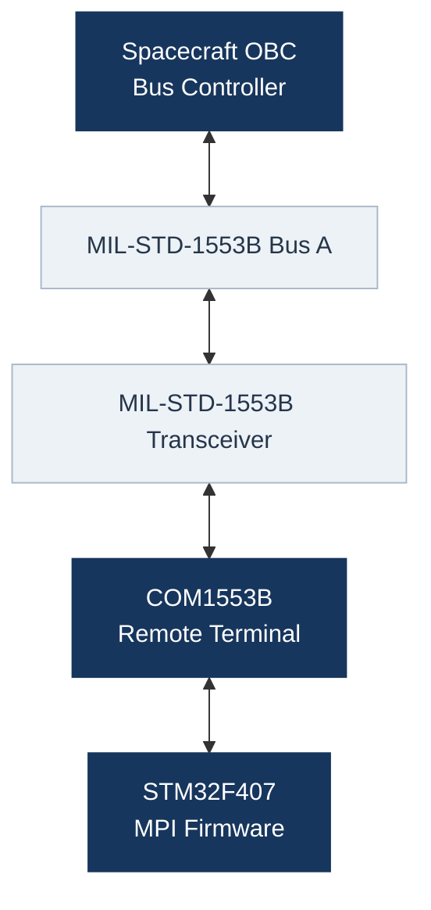

# Pinout

**Project:** FIRMWARE_1553  
**Microcontroller:** STM32F407VGT6  
**Development Board:** STM32F407G-DISC1  
**MIL-STD-1553B Controller:** COM1553B  
**Operating Mode:** Remote Terminal (RT)  
**Document Revision:** 0.1  
**Status:** Preliminary Design

---

## 1. Overview

This document defines the signal configuration and pin assignments between the STM32F407 microcontroller and the COM1553B MIL-STD-1553B controller.

The COM1553B operates in **Remote Terminal (RT)** mode as part of the Mexican Payload Interface (MPI), while the spacecraft On-Board Computer (OBC) operates as the Bus Controller (BC).

The STM32F407 manages the COM1553B through a 16-bit bidirectional parallel data bus and dedicated control, handshake, and status signals.

The objectives of this document are to:

- Identify the COM1553B interface signals.
- Define the corresponding STM32 GPIO assignments.
- Specify signal directions and GPIO configurations.
- Identify signals requiring interrupt-based handling.
- Prevent GPIO conflicts with other firmware modules.
- Maintain traceability between hardware configuration, firmware implementation, and validation.

> [!NOTE]
> Pin assignments marked as `TBD` have not yet been defined.
> The current configuration is preliminary and will be updated during hardware integration.

---

## 2. System Architecture

The communication architecture consists of the spacecraft OBC, the MIL-STD-1553B physical interface, the COM1553B controller, and the STM32F407 host processor.



The OBC controls communication scheduling and initiates MIL-STD-1553B transactions.

The COM1553B handles protocol-related operations, including Manchester encoding and decoding, command interpretation, and message control.

The STM32F407 exchanges application data and control information with the COM1553B through its parallel interface.

---

## 3. COM1553B Signal Description

This section identifies the controller signals according to the COM1553B SMART datasheet.

Signal directions are defined with respect to the STM32F407 unless otherwise indicated.

### 3.1 Parallel Data Bus

The COM1553B provides a 16-bit bidirectional data bus for transferring command, status, and application data between the controller and host processor.

| Signal | Direction | Description |
|:-------|:----------|:------------|
| D0 | Bidirectional | Data bit 0, least significant bit |
| D1 | Bidirectional | Data bit 1 |
| D2 | Bidirectional | Data bit 2 |
| D3 | Bidirectional | Data bit 3 |
| D4 | Bidirectional | Data bit 4 |
| D5 | Bidirectional | Data bit 5 |
| D6 | Bidirectional | Data bit 6 |
| D7 | Bidirectional | Data bit 7 |
| D8 | Bidirectional | Data bit 8 |
| D9 | Bidirectional | Data bit 9 |
| D10 | Bidirectional | Data bit 10 |
| D11 | Bidirectional | Data bit 11 |
| D12 | Bidirectional | Data bit 12 |
| D13 | Bidirectional | Data bit 13 |
| D14 | Bidirectional | Data bit 14 |
| D15 | Bidirectional | Data bit 15, most significant bit |

The bus must support both input and output operation.

The firmware shall configure the GPIO direction according to the current COM1553B transfer cycle.

Bus contention must be prevented by ensuring that the STM32F407 and COM1553B do not drive the same data lines simultaneously.

### 3.2 Configuration and Control Signals

| Signal | Direction | Function |
|:-------|:----------|:---------|
| CLK | STM32 → COM1553B | 12 MHz reference clock |
| POR | STM32 → COM1553B | Power-on reset control |
| RT/BC | STM32 → COM1553B | Remote Terminal / Bus Controller selection |
| CSTR | STM32 → COM1553B | Command Strobe |
| BGACK | STM32 → COM1553B | Bus Grant Acknowledge |
| DTACK | STM32 → COM1553B | Data Transfer Acknowledge |

**Control considerations:**

- `POR` is active low.
- `RT/BC = 1` selects Remote Terminal operation.
- `CSTR`, `BGACK`, and `DTACK` are active-low control signals.
- Control outputs must be initialized to safe states before communication begins.
- The required timing relationships shall follow the COM1553B datasheet.

### 3.3 Handshake Signals

| Signal | Direction | Function |
|:-------|:----------|:---------|
| CSTRA | COM1553B → STM32 | Command Strobe Acknowledge |
| DTR | COM1553B → STM32 | Data Transfer Request |

Both signals participate in the control and data transfer sequences.

`CSTRA` and `DTR` are active-low signals.

The final firmware will use hardware-assisted event detection where required to avoid missing short pulses.

Interrupt latency and timing requirements must be evaluated before selecting the final GPIO configuration.

### 3.4 Status and Monitoring Signals

| Signal | Direction | Function |
|:-------|:----------|:---------|
| R/W | COM1553B → STM32 | Read/write cycle indication |
| WE | COM1553B → STM32 | Write Enable |
| C/D | COM1553B → STM32 | Command/Data indication |
| TXMODE | COM1553B → STM32 | Transmission Mode indication |
| MC | COM1553B → STM32 | Message Complete |
| IM | COM1553B → STM32 | Invalid Message |
| MCF | COM1553B → STM32 | Mode Code Flag |
| VC | COM1553B → STM32 | Valid Command |

These signals provide information about the current operation and status of the controller.

The firmware will use them to coordinate transfers, identify message events, and detect communication errors.

The final use of GPIO polling, external interrupts, or hardware capture will depend on the required response times.

### 3.5 Manchester Interface

The COM1553B communicates with the MIL-STD-1553B transceiver through dedicated Manchester signals.

| Signal | COM1553B Direction | Function |
|:-------|:-------------------|:---------|
| MANIN | Input | Manchester receive input |
| Complementary MANIN | Input | Complementary receive input |
| MANOUT | Output | Manchester transmit output |
| Complementary MANOUT | Output | Complementary transmit output |

These signals connect the COM1553B to the external transceiver interface.

They are not part of the STM32 parallel GPIO interface.

The transceiver control and physical bus connections will be documented separately if required.

### 3.6 Power and Ground Signals

The COM1553B includes dedicated supply and ground connections, including:

- VCC
- VDD
- VBB
- GND

Power distribution and supply circuitry are handled by the hardware design.

This document focuses on the microcontroller signal interface.

---

## 4. STM32 Pin Assignment

The following tables define the mapping between COM1553B signals and STM32F407 pins.

**Assignment status:**

- `Configured`: Assigned in STM32CubeMX.
- `Pending`: Pin assignment not yet defined.
- `Pending Validation`: Configured but not experimentally verified.
- `Verified`: Confirmed through hardware testing.

### 4.1 Clock and Configuration

| COM1553B Signal | STM32 Pin | Configuration | Status |
|:----------------|:----------|:--------------|:-------|
| CLK | PE9 | TIM1_CH1, PWM | Pending Validation |
| POR | TBD | GPIO Output | Pending |
| RT/BC | TBD | GPIO Output | Pending |

The `RT/BC` signal will select Remote Terminal operation.

### 4.2 Control and Handshake

| COM1553B Signal | STM32 Pin | GPIO Configuration | Status |
|:----------------|:----------|:-------------------|:-------|
| CSTR | TBD | GPIO Output | Pending |
| BGACK | TBD | GPIO Output | Pending |
| DTACK | TBD | GPIO Output | Pending |
| CSTRA | TBD | GPIO Input / EXTI | Pending |
| DTR | TBD | GPIO Input / EXTI | Pending |

The final configuration will account for signal polarity, timing requirements, and interrupt availability.

### 4.3 Parallel Data Bus

| COM1553B Signal | STM32 Pin | GPIO Configuration | Status |
|:----------------|:----------|:-------------------|:-------|
| D0 | TBD | Bidirectional GPIO | Pending |
| D1 | TBD | Bidirectional GPIO | Pending |
| D2 | TBD | Bidirectional GPIO | Pending |
| D3 | TBD | Bidirectional GPIO | Pending |
| D4 | TBD | Bidirectional GPIO | Pending |
| D5 | TBD | Bidirectional GPIO | Pending |
| D6 | TBD | Bidirectional GPIO | Pending |
| D7 | TBD | Bidirectional GPIO | Pending |
| D8 | TBD | Bidirectional GPIO | Pending |
| D9 | TBD | Bidirectional GPIO | Pending |
| D10 | TBD | Bidirectional GPIO | Pending |
| D11 | TBD | Bidirectional GPIO | Pending |
| D12 | TBD | Bidirectional GPIO | Pending |
| D13 | TBD | Bidirectional GPIO | Pending |
| D14 | TBD | Bidirectional GPIO | Pending |
| D15 | TBD | Bidirectional GPIO | Pending |

The data bus pin assignment should minimize the number of GPIO ports involved in each 16-bit transfer.

Whenever practical, data bits should be grouped to simplify parallel read, write, and direction-control operations.

### 4.4 Status and Monitoring

| COM1553B Signal | STM32 Pin | GPIO Configuration | Status |
|:----------------|:----------|:-------------------|:-------|
| R/W | TBD | GPIO Input | Pending |
| WE | TBD | GPIO Input | Pending |
| C/D | TBD | GPIO Input | Pending |
| TXMODE | TBD | GPIO Input / EXTI | Pending |
| MC | TBD | GPIO Input / EXTI | Pending |
| IM | TBD | GPIO Input / EXTI | Pending |
| MCF | TBD | GPIO Input | Pending |
| VC | TBD | GPIO Input | Pending |

The use of EXTI is preliminary and will be finalized after reviewing timing constraints and EXTI line conflicts.

---

## 5. Clock Configuration

### 5.1 STM32 System Clock

The following configuration has been established in STM32CubeMX.

| Parameter | Configuration |
|:----------|:--------------|
| HSE Frequency | 8 MHz |
| SYSCLK | 168 MHz |
| HCLK | 168 MHz |
| APB1 Clock | 42 MHz |
| APB2 Clock | 84 MHz |
| APB1 Timer Clock | 84 MHz |
| APB2 Timer Clock | 168 MHz |

The main system clock is generated using the STM32 PLL.

### 5.2 COM1553B Clock Output

The COM1553B requires a 12 MHz clock reference.

TIM1 Channel 1 has been configured to generate this signal.

| Parameter | Configuration |
|:----------|:--------------|
| Timer | TIM1 |
| Channel | CH1 |
| Output Pin | PE9 |
| User Label | COM1553_CLK |
| Clock Source | Internal Clock |
| Timer Input Clock | 168 MHz |
| Prescaler | 0 |
| Counter Mode | Up |
| Counter Period | 13 |
| PWM Mode | PWM Mode 1 |
| Pulse | 7 |
| Output Polarity | High |
| GPIO Mode | Alternate Function Push-Pull |
| Pull-up / Pull-down | No Pull |
| GPIO Output Speed | Very High |
| Expected Frequency | 12 MHz |
| Expected Duty Cycle | 50% |

The PWM frequency is calculated as:

```text
f_PWM = f_TIM / ((PSC + 1) × (ARR + 1))

f_PWM = 168 MHz / ((0 + 1) × (13 + 1))

f_PWM = 12 MHz
```

The duty cycle is calculated as:

```text
Duty Cycle = CCR1 / (ARR + 1)

Duty Cycle = 7 / 14

Duty Cycle = 50%
```

> [!IMPORTANT]
> The 12 MHz clock has been configured in STM32CubeMX but has not yet been experimentally validated.
>
> Frequency, duty cycle, signal integrity, and timing must be verified with an oscilloscope before integration.

---

## 6. Interrupt and Timing Considerations

The firmware will use an interrupt-driven architecture for appropriate COM1553B communication events.

Potential interrupt sources include:

| Signal | Planned Detection | Purpose |
|:-------|:------------------|:--------|
| CSTRA | Falling edge | Command acknowledgment |
| DTR | Rising / falling edges | Data transfer synchronization |
| MC | Event detection | Message completion |
| IM | Event detection | Invalid message indication |
| TXMODE | Rising / falling edges | Transmission monitoring |

The interrupt design must consider:

1. STM32 EXTI line availability.
2. Interrupt priorities.
3. Interrupt service latency.
4. Timing requirements from the COM1553B datasheet.
5. Potential loss of closely spaced events.
6. Safe GPIO transitions during bidirectional transfers.
7. Error handling and timeout mechanisms.

Where GPIO interrupts are insufficient for precise timing, timer input capture or other hardware-assisted techniques may be evaluated.

The final interrupt strategy will be documented after the pin assignments are completed.

---

## 7. GPIO Design Guidelines

The pin assignment will follow these design principles:

1. **Preserve debugging access.**  
   PA13 and PA14 are reserved for the SWD interface.

2. **Reserve the COM1553B clock output.**  
   PE9 is assigned to TIM1_CH1.

3. **Optimize the parallel data bus.**  
   Group D0-D15 into as few GPIO ports as practical.

4. **Prevent EXTI conflicts.**  
   Signals requiring interrupts must use compatible EXTI lines.

5. **Avoid GPIO contention.**  
   The bidirectional bus must never be driven simultaneously by the STM32 and COM1553B.

6. **Preserve existing board resources.**  
   Pin assignments must account for the STM32F407G-DISC1 hardware connections.

7. **Support future MPI modules.**  
   Peripheral and GPIO allocation must consider the complete firmware architecture.

8. **Keep hardware configuration traceable.**  
   Every final pin assignment must be documented and reflected in STM32CubeMX.

9. **Validate timing-critical interfaces.**  
   GPIO assignments and electrical behavior must be verified against hardware measurements.

10. **Maintain safe initialization states.**  
    Control outputs and bidirectional data lines must be initialized without creating unintended transfers.

---

## 8. Hardware Validation

The following tests will be performed during firmware integration.

| Test | Description | Status |
|:-----|:------------|:-------|
| Clock Output | Verify 12 MHz frequency and duty cycle | Pending |
| Reset | Verify COM1553B POR sequence | Pending |
| RT Mode | Verify RT/BC configuration | Pending |
| Data Bus | Verify 16-bit read/write operation | Pending |
| Handshake | Verify CSTR, CSTRA, DTR, BGACK, and DTACK | Pending |
| Status Signals | Verify controller status indications | Pending |
| Interrupts | Verify event detection and latency | Pending |
| RT Communication | Verify Remote Terminal operation | Pending |
| MIL-STD-1553B Bus | Verify physical bus communication | Pending |

Experimental measurements and test results will be documented separately in the testing documentation.

---

## 9. Development Status

| Item | Status |
|:-----|:-------|
| STM32F407G-DISC1 selection | Completed |
| STM32 clock configuration | Configured |
| COM1553B 12 MHz clock setup | Pending Validation |
| Parallel data bus pinout | Pending |
| Control signal pinout | Pending |
| Status signal pinout | Pending |
| Interrupt configuration | Pending |
| COM1553B driver implementation | Pending |
| Remote Terminal firmware integration | Pending |
| Hardware communication validation | Pending |

---

## 10. References

1. Standard Microsystems Corporation, *COM1553B MIL-STD-1553B SMART Controller Datasheet*.
2. STMicroelectronics, *STM32F405/407 Reference Manual (RM0090)*.
3. STMicroelectronics, *STM32F407G-DISC1 User Manual (UM1472)*.
4. STMicroelectronics, *STM32CubeMX Documentation*.

---

## 11. Revision History

| Revision | Description |
|:---------|:------------|
| 0.1 | Initial signal classification, preliminary pin assignment, and TIM1 clock configuration |

---

**Project:** FIRMWARE_1553  
**Document:** Pinout  
**Status:** Preliminary Design
